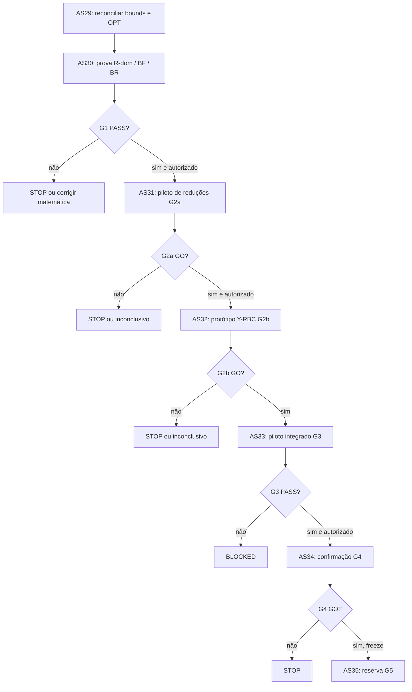

# Programa Y-RBC — Plano científico e matriz de dependências AS29–AS35

**Data de preparação:** 17/10/2026. **Baseline consultada:** branch `novos_testes`, HEAD consultado `f935abba9446a4b3b3524d021b961c7c1dd0a1a5`. **Natureza:** planejamento prospectivo a partir do parecer Astra pós-AS28; não foi executado nem aprovado como contribuição demonstrada.

## 1. Decisão e limites

O objetivo é investigar se um algoritmo exato em `y` combina **reduções seguras R-dom**, **mestre K**, **cortes BF de projeção**, **cortes BR de inviabilidade** e **oráculo físico de matching** com desempenho competitivo em instâncias principais do MIN-STATION de Das. A hipótese não é que a LP fique estritamente mais forte que COMP+K; o alvo é **tempo, bounds e incumbentes inteiras**. Reabrir parcialmente BC-y/CBI (E7/E8/E12) requer prova de que os novos componentes endereçam os gargalos medidos; não se trata de novo nome para o mesmo método.

**Estado científico:** AS25.1 FC-R classe B e AS28 C3 `NO_SIGNAL_BOUNDED_POLICY`; FC-R deixou de ser linha principal, disjunções globais descartadas, política C3 restrita encerrada. **AS26 permanece bloqueada.**

## 2. Roteiro e autorização

| Etapa | Spec | Natureza | Pré-condição | Produto principal | Resultado permitido |
|---|---|---|---|---|---|
| AS29 | `specs/as-29-yrbc-reconciliacao-lb-opt/` | documental | dados existentes | envelope/proveniência/errata | G0 PASS/BLOCKED |
| AS30 | `specs/as-30-yrbc-validacao-matematica/` | matemática | G0 | provas R-dom, BF, BR, microtestes | G1 PASS/BLOCKED |
| AS31 | `specs/as-31-yrbc-reducoes-preprocessamento/` | experimento | G1 PASS + pré-registro | efeito isolado das reduções | G2a GO/STOP/INCONCLUSIVE |
| AS32 | `specs/as-32-yrbc-prototipo-envelope/` | protótipo | G2a GO aprovado | mestre y + BF/BR/primal | G2b GO/STOP/INCONCLUSIVE |
| AS33 | `specs/as-33-yrbc-piloto-integrado/` | engenharia/robustez | G2b GO | callbacks e telemetria | G3 PASS/BLOCKED/STOP |
| AS34 | `specs/as-34-yrbc-comparacao-pareada/` | confirmação | G3 PASS + protocolo congelado | comparativo exato com seeds | G4 GO/STOP/INCONCLUSIVE |
| AS35 | `specs/as-35-yrbc-avaliacao-reservada/` | avaliação blindada | G4 GO + freeze | generalização | G5 + parecer independente |

## 3. Invariantes científicos

1. O problema é o MIN-STATION de Das: grafo de entrada não direcionado, `r` comum, `S∩T` pode ocorrer, instalação em todo `V`, matching anônimo e estações sem capacidade física.
2. COMP histórico E7–E14 nomeia em algumas fontes U+K; na nomenclatura AS, COMP é U e COMP+K é U+C1+C2+C4-DM. Usar nomenclatura AS nos novos artefatos e mostrar aliases.
3. Núcleo IP de cobertura é relaxação inteira do problema: sua solução não é UB físico sem oráculo. Não misturar LB de MIP histórico com LP de campanhas de menor orçamento.
4. Nenhuma prova ou resultado exploratório de uma seed do Astra é validação confirmatória. Vienna e Room são alvos razoáveis de ablação, mas o orçamento prospectivo não pode ser escolhido a posteriori.
5. AS29/30 podem produzir documentos/testes sem Gurobi; AS31 em diante exigem protocolo pré-registrado e Gurobi real no ambiente do pesquisador.
6. `y_u=0` por dominância deve preservar **pelo menos uma solução ótima**, mas não necessariamente todas. Nunca remover os próprios vértices S/T do problema, somente restringir seu uso como estação e trânsito conforme prova.
7. BF de mincut: `Σ κ_v y_v ≥ m − c_0(X)` só para corte finito e papel de terminal corretamente modelado. BR: `y(Z(X)) ≥ 1` exige certificado independente. Falha => abstenção/STOP, jamais corte aproximado.
8. Qualquer otimização de performance precisa manter subproblema físico exato e validar incumbentes antes de aceitá-las. Interromper callback antes da validação de MIPSOL é proibido.
9. Não abrir resultados da partição `avaliacao` até o freeze de AS35. AS29 pode listar metadados, mas não inspecionar desempenho reservado.
10. Nenhum gate libera automaticamente AS26, mudança de variantes, `git push` ou alteração de evidência histórica.

## 4. Evidências e riscos que motivam a proposta

| Elemento | Evidência relatada pelo Astra | Interpretação permitida |
|---|---|---|
| R-dom Vienna I056 | 1.360/1.991 instalações; arcos 381.600→66.042; LP 21 s→3,1 s | Sonda pós-hoc de uma seed, sem generalização |
| R-dom MAPF Room | 330/682; arcos 11.622→4.224; LP 0,5 s→0,1 s | Candidato a ganho de preparação; MIP ainda incerto |
| PUC CC9, CC3, W3C571 | 0% fixações nos casos relatados | R-dom não é universal; manter esses casos no denominador |
| E8 BC-y/CBI | callback 70–99,9% tempo, starts enormes | Reabertura só se atacar os gargalos concretos |
| F-CC e outras famílias | falhas de escala e ganhos restritos | Não voltar a técnicas caras sem evidência nova |
| LB* CC9 | tabela da linha de base registra 30; Astra localizou ótimo numérico 31 em AS06/AS09 | AS29 deve validar, não alterar histórico silenciosamente |

## 5. Gates e política STOP

### G0 (AS29)

Proveniência obrigatória para todos os casos de desenvolvimento que entram nos gates: instância/hash, baseline, LP, MIP bound, solução física, status, seeds, WorkLimit, data/commit. Distinguir `OPT` provado numericamente, `LB*` histórico e desconhecido. Falta de fonte é BLOCKED.

### G1 (AS30)

Prova integral R-dom (incluindo dominâncias em cadeia, gêmeos e terminais), projeção BF e BR no tratamento `S∩T`, mais microverificação adversarial. Um único contraexemplo bloqueia AS31.

### G2a (AS31)

Pré-registrar **antes** dos solves: casos de desenvolvimento, três seeds, `WorkLimit` pareado, métricas, política R-dom e interrupção. **GO candidato:** em dois grafos brutos independentes, reduzir tempo de raiz ≥50% sem perda do bound, ou tempo até OPT por fator ≥2, ou melhorar LB/UB inteiro ≥1 estação, **com benefício MIP verificável e sem regressão grave**; avaliar custo total. **STOP:** ausência de ganho MIP/custo e pouca redução fora de PUC. **INCONCLUSIVE:** cobertura/censura insuficientes. Revise os limiares antes de congelar o protocolo, nunca após os dados.

### G2b (AS32)

Protótipo deve mostrar melhoria frente ao envelope **pareado** em ao menos dois grafos brutos, com ablação e tempo de callback medianamente <50%, sem piora generalizada ou invalidez física; medir múltiplas métricas inteiras. O alvo de superar `max(núcleo, COMP)` **não é garantia teórica sob tempo fixo**, mas objetivo empírico. STOP se callback domina ou no gain.

### G3 (AS33)

Verificador independente confirma 0 cortes incorretos, 0 incumbentes fisicamente inválidas, telemetria completa e guarda de tempo/certificados robusta. Ausência de prova => BLOCKED.

### G4 (AS34)

Desenho confirmatório (p.ex. 600 s e três seeds, sujeito à revisão pré-registro) e comparação contra COMP, COMP+K, IP núcleo, BC-y, CBI e Y-RBC. Decidir por bounds, UB, gap, tempo e nós, com variação e censuras, não só ganho LP. Exigir sinal em ao menos dois grafos brutos; critérios exatos congelados antes da campanha.

### G5 (AS35)

Congelar commit, hashes, protocolo, orçamento, solver e lista de instâncias; rodar uma avaliação sem ajustes de política. Verificador independente valida toda incumbente e resultado comparado, relata ganhos e falhas; nunca usar a reserva para tuning.

## 6. Regras de execução TLC

- Cada diretório tem `spec.md`, `design.md`, `tasks.md` em estado DRAFT; sem `validation.md` até trabalho e verificador efetivos.
- Rodar validadores da skill por arquivo específico: `python3 .claude/skills/tlc-spec-driven/scripts/validate_spec.py specs/as-29-.../spec.md --strict`, análogo para tasks.
- Executar tarefas com testes baseados nos critérios de aceite, commits atômicos por tarefa, evidência de gate por arquivo:linha e Verifier independente após a última tarefa.
- Ao terminar uma fase, o pesquisador deve aprovar o gate antes de desbloquear a fase seguinte. Não rodar campanhas pela criação destas specs.

## 7. Fontes

- [Parecer Astra pós-AS28](../../reference/tecnico/parecer-astra-pos-as28-yrbc.md) — parecer sob revisão, não ciência certificada.
- [Direções de PLI](../../reference/tecnico/direcoes-pli-min-station.md) — Teoremas de BF/BR e histórico.
- [Resultados E8](../../reference/experimentos/resultados-e8-pli.md) — BC-y/CBI e gargalos.
- [Linha de base](../../reference/experimentos/resultados-linha-de-base.md) — LB* e UB*.
- [AS28](../../reference/experimentos/as28-resultado-lp-c3.md) — encerramento do C3 limitado.
- [RESEARCH.md](../../../../RESEARCH.md) — objetivo científico do projeto.
