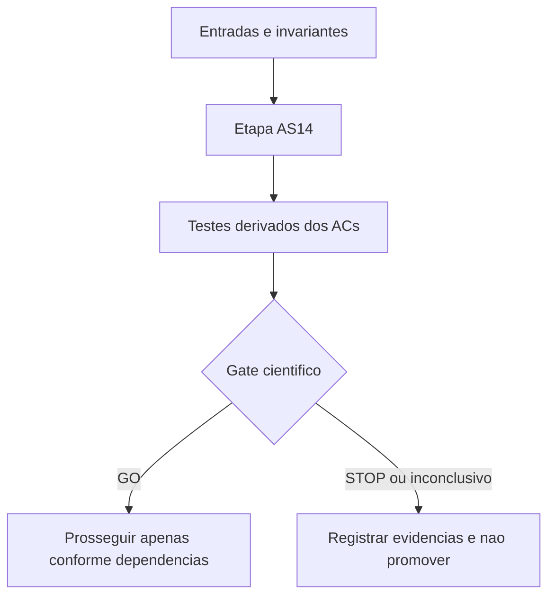

# AS14 — Oráculo certificado de viabilidade para suportes H2/HL — Design

**Spec:** `specs/as-14-oraculo-viabilidade-matching/spec.md`  
**Status:** Implementado localmente — evidência em `implementation-evidence.md`; verificação independente pendente.

## Architecture Overview

Contrato implementado: `MatchingOracle.check(PhysicalInstance, allowed_stations, budget_s=None) -> ViabilityResult` (VIABLE/INFEASIBLE/UNKNOWN; ν, matching, Hall, elapsed, calls e fingerprint). A implementação deve localizar e adaptar o verificador existente, sem duplicar uma rotina de verdade. A fronteira de certificação NÃO pode usar somente a instalação corrente y*, nem somente a rede de COMP como prova de viabilidade física.

## Code Reuse Analysis

| Artefato existente | Papel | Cuidado |
|---|---|---|
| `experiments/alternative-formulations/as02_model_a.py` | Controle COMP/U e K do comparador | Confirmar builder e política de relaxação/MIP no checkout usado. |
| `experiments/cuts/cuts.py` | C1/C2/C4-DM, ordenação de suportes, possíveis validadores existentes | Não trocar K existente, nem confundir C4-DM com todo Hall multissalto. |
| `docs/technical/plans/execucao/as00-benchmark-protocolo.md` | Seleção de desenvolvimento/avaliação e orçamento | Preservar provenance e grupos de grafos brutos. |
| `docs/technical/reference/baseline-e-metodo/protocolo-comparacao-pareada.md` | Isolar variáveis e orçamento comparável | Não misturar WorkLimit e TimeLimit. |

**Fontes para conferir no Execute (codebase primeiro):** `CLAUDE.md`, `docs/project-overview.md`, `RESEARCH.md`, `docs/context-ai/min-station-domain.md`, `docs/context-ai/base-formulation.md`, `experiments/alternative-formulations/as02_model_a.py`, `experiments/cuts/cuts.py`, `docs/technical/plans/execucao/as00-benchmark-protocolo.md`, `docs/technical/reference/baseline-e-metodo/protocolo-comparacao-pareada.md`.

## Components

| Entregável | Local proposto | Interface/comportamento esperado |
|---|---|---|
| Definir tipos triestado e formato de evidência | `experiments/cuts/h2_oracle_schema.py` (implementado) | Serialização determinística e contrato VIABLE/INFEASIBLE/UNKNOWN. |
| Implementar adaptador do oráculo físico de matching | `experiments/cuts/h2_oracle.py` (implementado) | Correspondência 1:1 com validador independente em microinstâncias. |
| Adicionar cache canônico e orçamento por chamada | `experiments/cuts/h2_oracle_cache.py` (implementado) | Teste de colisão entre instâncias e injeção de timeout. |
| Fechar regressão exaustiva e profiling do oráculo | `experiments/cuts/test_h2_oracle.py` (implementado) | Casos físicos, S∩T, falsos negativos e custos por ν. |

## Data Models

Todo registro experimental/certificado desta etapa terá: `schema_version`, `instance_sha256`, `source_commit`, `stage`, `status`, `elapsed_wall_s`, `evidence_path`, `budget_s`, `cut_family`, `cut_hash`, `validator_identity` quando aplicável. Para H2 usar suporte canônico `R`, conjuntos certificados `Bhat`, coeficientes 1/2 e RHS 2; para HL usar `R`, coeficientes racionais e β certificado. Campos inaplicáveis devem ser omitidos, não inventados.

## Error Handling Strategy

| Evento | Tratamento |
|---|---|
| Oráculo desconhecido, timeout ou erro | UNKNOWN/abstenção; jamais inferir inviabilidade. |
| Prova contradita | UNPROVEN/STOP; nenhuma emissão de corte dependente. |
| Sem suporte violado | NO_CUT, não confundir com inexistência global de corte. |
| Resultado LP/MIP censurado | Preservar métrica indisponível como ausente e motivo explícito. |
| Instância ou corte com SHA incompatível | INVALID_INPUT e bloquear comparação. |

## Risks & Concerns

| Risco | Impacto | Mitigação |
|---|---|---|
| Matching anônimo confundido com pareamento fixo | Corte inválido | Testes independentes com múltiplos matchings e S∩T. |
| Deficiência de Hall confundida com quantidade de estações | RHS incorreto | Certificar escolhas de instalações distintas; nunca usar déficit diretamente. |
| Heurística de suportes confundida com certificação | Desigualdade insegura | Separar seleção de R e prova da linha contra F=V\R. |
| Aumento do LB puro sem ganho após raiz MIP | Regressão de desempenho | Comparar bound após cuts do solver e tempo de separação. |
| Repetir K, CG/zero-half, CBI, C6 ou limite global | Contribuição redundante | Anotar controles históricos e medir ganho marginal. |

## Tech Decisions

- Usar esta etapa como pesquisa experimental **separada**: não trocar a formulação de produção nem alterar os freezes.
- Derivar testes dos ACs e executar verificador independente após implementação.
- Cada gate pode terminar com resultado negativo auditável; nenhuma etapa posterior começa automaticamente em caso de STOP.
- As políticas específicas de AS14 constam no `spec.md` e em `tasks.md`.

## Acceptance Gate

GO se não houver divergência com verificador físico independente e nenhum UNKNOWN tiver sido promovido a INFEASIBLE; caso contrário STOP.

## Implementation Notes (AS14 execution, 2026-10-14)

- **Oráculo físico reaproveitado:** `independent_validator.destinos_alcancaveis`/`_grafo_unitario` calcula alcance em `(v, bateria)` com estações permitidas. O matching exato novo devolve testemunha bijetiva para `VIABLE` ou conjunto de origens com deficiência de Hall para `INFEASIBLE`. A auditoria confronta `independent_validator.viavel` e o `reach_matching_oracle` da AS13.
- **Cache:** somente certificações VIABLE/INFEASIBLE, por hash SHA-256 de `V, E, S, T, r` e `C` canônico; conflito com monotonicidade força `UNKNOWN` por erro, sem emitir corte. `PhysicalInstance` congela cópias das adjacências para evitar identidade mutável.
- **Budget:** `budget_s` mede tempo monotônico e verifica entre chamadas de alcance e operações do matching; é **cooperativo** (uma operação bloqueante individual pode terminar após o prazo, mas o resultado é rebaixado a UNKNOWN). Não equivale a interrupção preemptiva de sistema operacional.
- **H2:** `classify_h2` calcula `F=V\R`, não emite corte com complemento UNKNOWN/VIABLE, e só inclui em `Bhat` candidatos com INFEASIBLE certificado; candidatos não examinados ou UNKNOWN recebem coeficiente 2.
- **HL:** a AS14 não implementa separação HL nem β; apenas infraestrutura física de oráculo. A separação pertence a etapas seguintes.
- **Relatório:** `verify_as14_oracle.py` compara 742 máscaras e custos por tamanho ν do matching; `verify_as14_discrimination.py` injeta sete mutações reais em diretórios temporários.
- **Gate:** execução e regressões locais PASS; parecer independente e GO formal **pendentes**.
