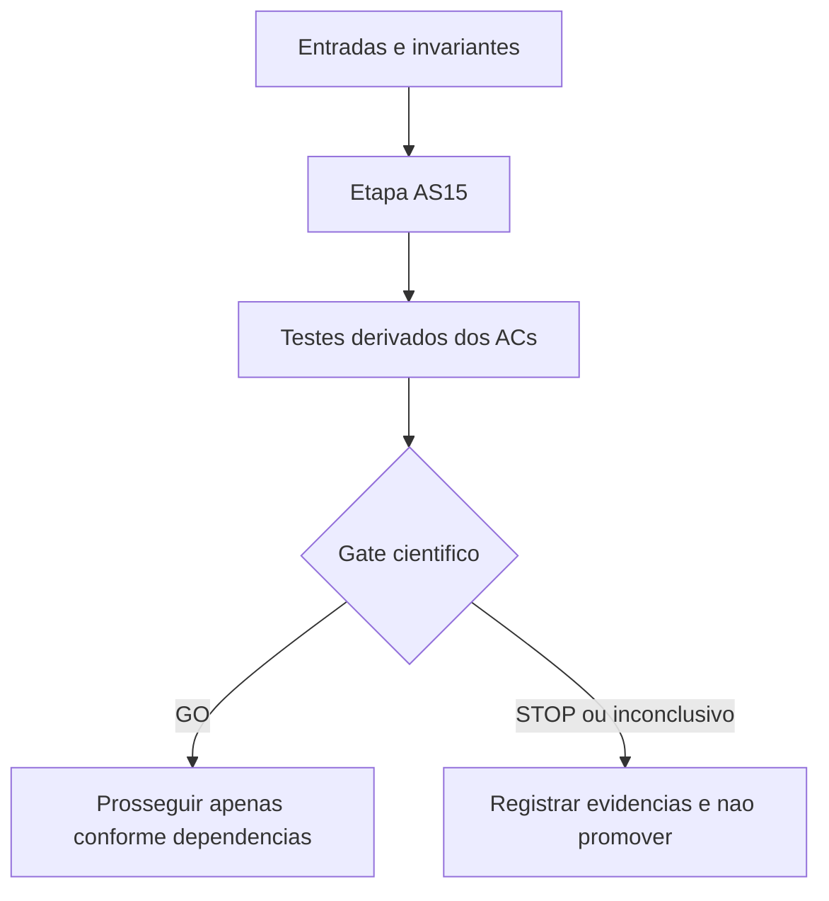

# AS15 — Geração, seleção e certificação de cortes H2 — Design

**Spec:** `specs/as-15-separacao-h2/spec.md`  
**Status:** Implementado localmente — validação independente e Ruff pendentes.

## Architecture Overview

Separar `h2_cut` (representação imutável), `h2_supports` (heurística não certificadora), `h2_separator` (certifica e filtra); reusar `cortes_ordenados`/`ExactCutValidator` após verificar contratos. Teste de corte sempre calcula F=V\R, e a busca não deve depender de fluxo fracionário para declarar validade. Usar y* somente para priorização/violação.

## Code Reuse Analysis

| Artefato existente | Papel | Cuidado |
|---|---|---|
| `experiments/alternative-formulations/as02_model_a.py` | Controle COMP/U e K do comparador | Confirmar builder e política de relaxação/MIP no checkout usado. |
| `experiments/cuts/cuts.py` | C1/C2/C4-DM, ordenação de suportes, possíveis validadores existentes | Não trocar K existente, nem confundir C4-DM com todo Hall multissalto. |
| `docs/technical/plans/execucao/as00-benchmark-protocolo.md` | Seleção de desenvolvimento/avaliação e orçamento | Preservar provenance e grupos de grafos brutos. |
| `docs/technical/reference/baseline-e-metodo/protocolo-comparacao-pareada.md` | Isolar variáveis e orçamento comparável | Não misturar WorkLimit e TimeLimit. |

**Fontes para conferir no Execute (codebase primeiro):** `CLAUDE.md`, `docs/project-overview.md`, `RESEARCH.md`, `docs/context-ai/min-station-domain.md`, `docs/context-ai/base-formulation.md`, `experiments/alternative-formulations/as02_model_a.py`, `experiments/cuts/cuts.py`, `docs/technical/plans/execucao/as00-benchmark-protocolo.md`, `docs/technical/reference/baseline-e-metodo/protocolo-comparacao-pareada.md`.

## Components

| Entregável | Local proposto | Interface/comportamento esperado |
|---|---|---|
| Representar e certificar a desigualdade H2 | `experiments/cuts/h2_cut.py` (proposto) | Coefficients/rhs de H2 e validade por enumeração independente. |
| Implementar seleção determinística de suportes | `experiments/cuts/h2_supports.py` (proposto) | Suportes relevantes com deduplicação, tamanho/calls limitados. |
| Implementar separador orçamentado de H2 | `experiments/cuts/h2_separator.py` (proposto) | Certificações, violação, UNKNOWN e sem emissão indevida. |
| Adicionar controle exaustivo e diagnóstico do separador | `experiments/cuts/test_h2_separator.py` (proposto) | Validar precisão e medir recall em grafos pequenos. |

## Data Models

Todo registro experimental/certificado desta etapa terá: `schema_version`, `instance_sha256`, `source_commit`, `stage`, `status`, `elapsed_wall_s`, `evidence_path`, `budget_s`, `cut_family`, `cut_hash`, `validator_identity` quando aplicável. Para H2 usar suporte canônico `R`, conjuntos certificados `Bhat`, coeficientes 1/2 e RHS 2; para HL usar `R`, coeficientes racionais e β certificado. Campos inaplicáveis devem ser omitidos, não inventados.

## Error Handling Strategy

| Evento | Tratamento |
|---|---|
| Oráculo desconhecido, timeout ou erro | UNKNOWN/abstenção; jamais inferir inviabilidade. |
| Prova contradita | UNPROVEN/STOP; nenhuma emissão de corte dependente. |
| Sem suporte violado | NO_CUT, não confundir com inexistência global de corte. |
| Resultado LP/MIP censurado | Preservar métrica indisponível como ausente e motivo explícito. |
| Instância ou corte com SHA incompatível | INVALID_INPUT e bloquear comparação. |

## Risks & Concerns

| Risco | Impacto | Mitigação |
|---|---|---|
| Matching anônimo confundido com pareamento fixo | Corte inválido | Testes independentes com múltiplos matchings e S∩T. |
| Deficiência de Hall confundida com quantidade de estações | RHS incorreto | Certificar escolhas de instalações distintas; nunca usar déficit diretamente. |
| Heurística de suportes confundida com certificação | Desigualdade insegura | Separar seleção de R e prova da linha contra F=V\R. |
| Aumento do LB puro sem ganho após raiz MIP | Regressão de desempenho | Comparar bound após cuts do solver e tempo de separação. |
| Repetir K, CG/zero-half, CBI, C6 ou limite global | Contribuição redundante | Anotar controles históricos e medir ganho marginal. |

## Tech Decisions

- Usar esta etapa como pesquisa experimental **separada**: não trocar a formulação de produção nem alterar os freezes.
- Derivar testes dos ACs e executar verificador independente após implementação.
- Cada gate pode terminar com resultado negativo auditável; nenhuma etapa posterior começa automaticamente em caso de STOP.
- As políticas específicas de AS15 constam no `spec.md` e em `tasks.md`.

## Acceptance Gate

GO se HB e casos negativos passarem, todo corte emitido for comprovadamente válido nas microinstâncias e ao menos um corte não redundante for encontrado com custo registrado; não exigir ganho de benchmark ainda.

## Implementação efetiva

- `h2_cut.py`: estrutura imutável, coeficientes 1/2, hash tipado, representação `to_dict`.
- `h2_supports.py`: FULL_V, candidatos Hall/K, pares limitados e suporte fracionário, sem enumeração global.
- `h2_separator.py`: pré-filtro `y*(R) >= 2`, oráculo AS14, budget global/por suporte/calls, classificação parcial conservadora, violação estrita, deduplicação, exportação append-only.
- `verify_as15_separation.py`: enumeração independente física de microinstâncias e testemunha HB COMP+K versus COMP+K+H2; não é o parecer independente de um revisor externo.
- `verify_as15_mutations.py`: 7 mutantes de código em cópias temporárias; não modifica o workspace.

**Desvio operacional explícito:** não foram criados commits locais, pois o usuário receberá um patch incremental para aplicar no seu próprio checkout; o commit/provenance e o parecer de revisor distinto continuam pendentes.
