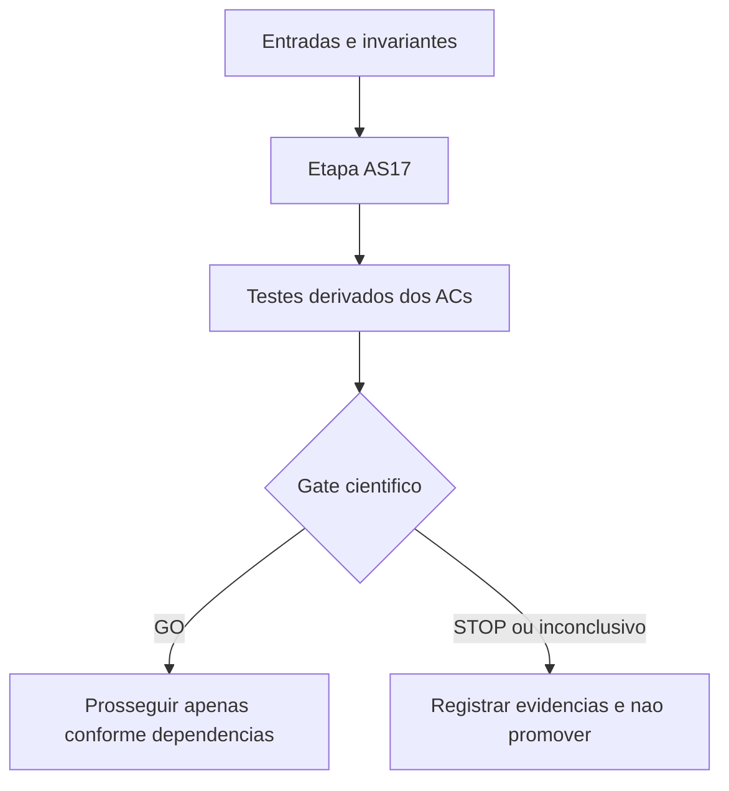

# AS17 — Piloto MIP de H2 na raiz sobre COMP+K — Design

**Spec:** `specs/as-17-piloto-mip-h2/spec.md`  
**Status:** Draft — decisões pendentes de aprovação e verificação local na execução.

## Architecture Overview

Reusar `compile_u`/builder do modelo U, K congelado, validadores físicos e recursos de coleta de incumbentes de `experiments/formulation-comparison/as06_mip.py` (confirmar caminho local antes de programar). Separação externa prévia na raiz, NÃO callbacks na árvore. Nenhum limite/resultado da Formulação C é usado.

## Code Reuse Analysis

| Artefato existente | Papel | Cuidado |
|---|---|---|
| `experiments/alternative-formulations/as02_model_a.py` | Controle COMP/U e K do comparador | Confirmar builder e política de relaxação/MIP no checkout usado. |
| `experiments/cuts/cuts.py` | C1/C2/C4-DM, ordenação de suportes, possíveis validadores existentes | Não trocar K existente, nem confundir C4-DM com todo Hall multissalto. |
| `docs/technical/plans/execucao/as00-benchmark-protocolo.md` | Seleção de desenvolvimento/avaliação e orçamento | Preservar provenance e grupos de grafos brutos. |
| `docs/technical/reference/baseline-e-metodo/protocolo-comparacao-pareada.md` | Isolar variáveis e orçamento comparável | Não misturar WorkLimit e TimeLimit. |

**Fontes para conferir no Execute (codebase primeiro):** `CLAUDE.md`, `docs/project-overview.md`, `RESEARCH.md`, `docs/context-ai/min-station-domain.md`, `docs/context-ai/base-formulation.md`, `experiments/alternative-formulations/as02_model_a.py`, `experiments/cuts/cuts.py`, `docs/technical/plans/execucao/as00-benchmark-protocolo.md`, `docs/technical/reference/baseline-e-metodo/protocolo-comparacao-pareada.md`.

## Components

| Entregável | Local proposto | Interface/comportamento esperado |
|---|---|---|
| Especificar política MIP de raiz e resultados censurados | `docs/technical/plans/execucao/as17-preregistro-mip-h2.md` (proposto) | Plano pareado, custos e modos de falha congelados. |
| Implementar construção MIP com H2 pré-certificado | `experiments/cuts/h2_root_mip.py` (proposto) | Integração sem mudar COMP+K, com teste de invariância inteira. |
| Implementar execução MIP e validação física do UB | `experiments/cuts/run_h2_mip.py` (proposto) | Tempo total, status, UB física, LB, gap e nós rastreados. |
| Analisar controle, regressões e replicações condicionais | `docs/technical/reference/experimentos/as17-resultado-mip-h2.md` (proposto) | Evidências, comparação root bounds e gate GO/STOP/INVESTIGATE. |

## Data Models

Todo registro experimental/certificado desta etapa terá: `schema_version`, `instance_sha256`, `source_commit`, `stage`, `status`, `elapsed_wall_s`, `evidence_path`, `budget_s`, `cut_family`, `cut_hash`, `validator_identity` quando aplicável. Para H2 usar suporte canônico `R`, conjuntos certificados `Bhat`, coeficientes 1/2 e RHS 2; para HL usar `R`, coeficientes racionais e β certificado. Campos inaplicáveis devem ser omitidos, não inventados.

## Error Handling Strategy

| Evento | Tratamento |
|---|---|
| Oráculo desconhecido, timeout ou erro | UNKNOWN/abstenção; jamais inferir inviabilidade. |
| Prova contradita | UNPROVEN/STOP; nenhuma emissão de corte dependente. |
| Sem suporte violado | NO_CUT, não confundir com inexistência global de corte. |
| Resultado LP/MIP censurado | Preservar métrica indisponível como ausente e motivo explícito. |
| Instância ou corte com SHA incompatível | INVALID_INPUT e bloquear comparação. |

## Risks & Concerns

| Risco | Impacto | Mitigação |
|---|---|---|
| Matching anônimo confundido com pareamento fixo | Corte inválido | Testes independentes com múltiplos matchings e S∩T. |
| Deficiência de Hall confundida com quantidade de estações | RHS incorreto | Certificar escolhas de instalações distintas; nunca usar déficit diretamente. |
| Heurística de suportes confundida com certificação | Desigualdade insegura | Separar seleção de R e prova da linha contra F=V\R. |
| Aumento do LB puro sem ganho após raiz MIP | Regressão de desempenho | Comparar bound após cuts do solver e tempo de separação. |
| Repetir K, CG/zero-half, CBI, C6 ou limite global | Contribuição redundante | Anotar controles históricos e medir ganho marginal. |

## Tech Decisions

- Usar esta etapa como pesquisa experimental **separada**: não trocar a formulação de produção nem alterar os freezes.
- Derivar testes dos ACs e executar verificador independente após implementação.
- Cada gate pode terminar com resultado negativo auditável; nenhuma etapa posterior começa automaticamente em caso de STOP.
- As políticas específicas de AS17 constam no `spec.md` e em `tasks.md`.

## Acceptance Gate

GO condicionado a benefício MIP replicável sem invalidar incumbentes; se H2 só melhora LP, registrar conclusão parcial e STOP para expansão da busca. Sem passagem automática para 3600s.
