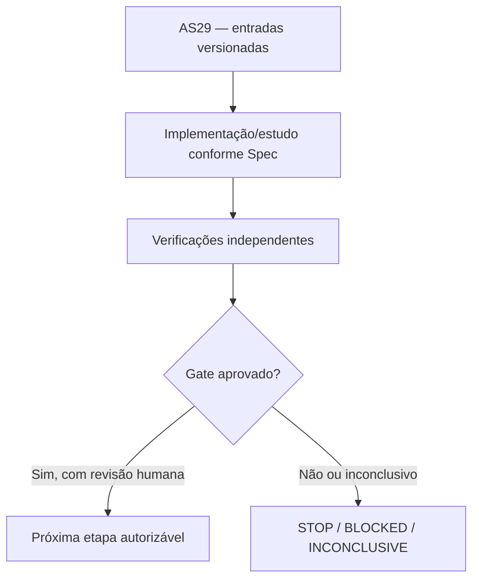

# AS29 — Design técnico

**Spec:** `specs/as-29-yrbc-reconciliacao-lb-opt/spec.md`
**Status:** DRAFT — não implementado.

## Architecture Overview

**Contexto de decisão:** A linha de base reúne LP, limites MIP, ótimo de núcleo e incumbentes físicos sob orçamentos diferentes. Há divergências históricas, especialmente CC9 (OPT=31 reportado em AS06/AS09, enquanto a tabela de LB* da Spec A marca 30) e artefatos anteriores à correção de K. Sem proveniência rigorosa, comparar Y-RBC com o envelope pode induzir uma conclusão falsa.

## Abordagem e fronteiras

Agrupar por identidade física de instância e hash bruto, nunca pelo prefixo PUC isolado. Manter três colunas distintas: LP ótimo, melhor MIP bound e UB de instalação comprovada. Para OPT=31 de CC9, verificar fonte AS06/AS09 e status numérico antes de atualizar a régua. Reportar envelope por seed e orçamento e outro envelope histórico meramente informativo. Incluir revisão específica de E9 anterior à correção de C4-DM e nomenclatura COMP E7–E14 versus AS.

## Code Reuse Analysis

| Fonte existente | Papel / verificação necessária |
|---|---|
| `results/benchmark/linha_base.csv` | Reutilizar apenas depois de conferir versão, semântica, hashes e permissões. |
| `docs/technical/reference/experimentos/resultados-linha-de-base.md` | Reutilizar apenas depois de conferir versão, semântica, hashes e permissões. |
| `docs/technical/reference/experimentos/resultados-e8-pli.md` | Reutilizar apenas depois de conferir versão, semântica, hashes e permissões. |
| `docs/technical/reference/experimentos/as28-resultado-lp-c3.md` | Reutilizar apenas depois de conferir versão, semântica, hashes e permissões. |
| `instances/manifest.csv` | Reutilizar apenas depois de conferir versão, semântica, hashes e permissões. |

## Components and Interfaces

| Artefato previsto | Responsabilidade |
|---|---|
| `docs/technical/reference/experimentos/as29-envelope-lb-opt.md` | Documento/manifesto auditável |
| `docs/technical/reference/experimentos/as29-envelope-proveniencia.csv` | Documento/manifesto auditável |
| `docs/technical/reference/experimentos/as29-erratas-e-incompatibilidades.md` | Documento/manifesto auditável |

## Contratos de integridade e evidência

- Toda instância recebe ID físico, SHA-256 bruto, classe, partição, autonomia `r` e cardinalidades `|S|`, `|T|`.
- Todo teste numérico tem versão de Gurobi, configuração, seed, limite de trabalho, tempo, status e natureza da certificação.
- Uma incumbente `y` só conta como UB físico depois de validação independente de viabilidade; ótimo do núcleo é apenas LB, salvo validação adicional.
- Resultados censurados e falhas de certificado são explícitos e contam na cobertura.
- Mudança de política após resultado é exploratória e exige novo pré-registro; sem reclassificação retroativa.
- Nenhuma etapa possui permissão implícita para fazer push, mexer nos dados de avaliação ou desbloquear AS26.

## Risks & Concerns

| Risco concreto | Consequência | Mitigação |
|---|---|---|
| LB* é bound numérico e pode ser confundido com certificado racional | Falso ganho, incorretude ou baixa reprodutibilidade | Exigir o certificado/teste e registrar STOP/INCONCLUSIVE quando faltar prova. |
| Núcleo inteiro fornece LB mas sua incumbente pode ser fisicamente inviável | Falso ganho, incorretude ou baixa reprodutibilidade | Exigir o certificado/teste e registrar STOP/INCONCLUSIVE quando faltar prova. |
| Misturar resultados de versões e orçamentos diferentes distorce ganhos | Falso ganho, incorretude ou baixa reprodutibilidade | Exigir o certificado/teste e registrar STOP/INCONCLUSIVE quando faltar prova. |

## Tech Decisions

| Decisão | Escolha | Racional |
|---|---|---|
| Escopo temporal | AS29 somente; sem executar a etapa seguinte | Gates devem ser aprovados separadamente. |
| Organização | `specs/as-XX-*` | Padrão concreto já utilizado pelo MIN-STATION, apesar do default `.specs/features/` da skill. |
| Validação | Scripts `validate_spec.py` e `validate_tasks.py` da skill | Passam nos diretórios explicitamente apontados. |
| Gate | G0 — Fontes reconciliadas | G0 PASS: 100% dos casos de desenvolvimento usados nos futuros gates com hash, LB fonte, UB fisicamente validado e classe de status; divergências explicitamente abertas ou resolvidas; CC9 contextualizada. G0 BLOCKED se não houver rastro de proveniência suficiente. |

## Critérios de abstenção

- Se prova, comparação ou certificado estiverem incompletos: registrar hipótese/INCONCLUSIVE e não inferir GO.
- Se o teste contradisser uma hipótese matemática: registrar contraexemplo com instância mínima e bloquear dependentes.
- Se não houver Gurobi disponível: executar apenas testes independentes e dry-run, sem preencher resultados MIP fictícios.
