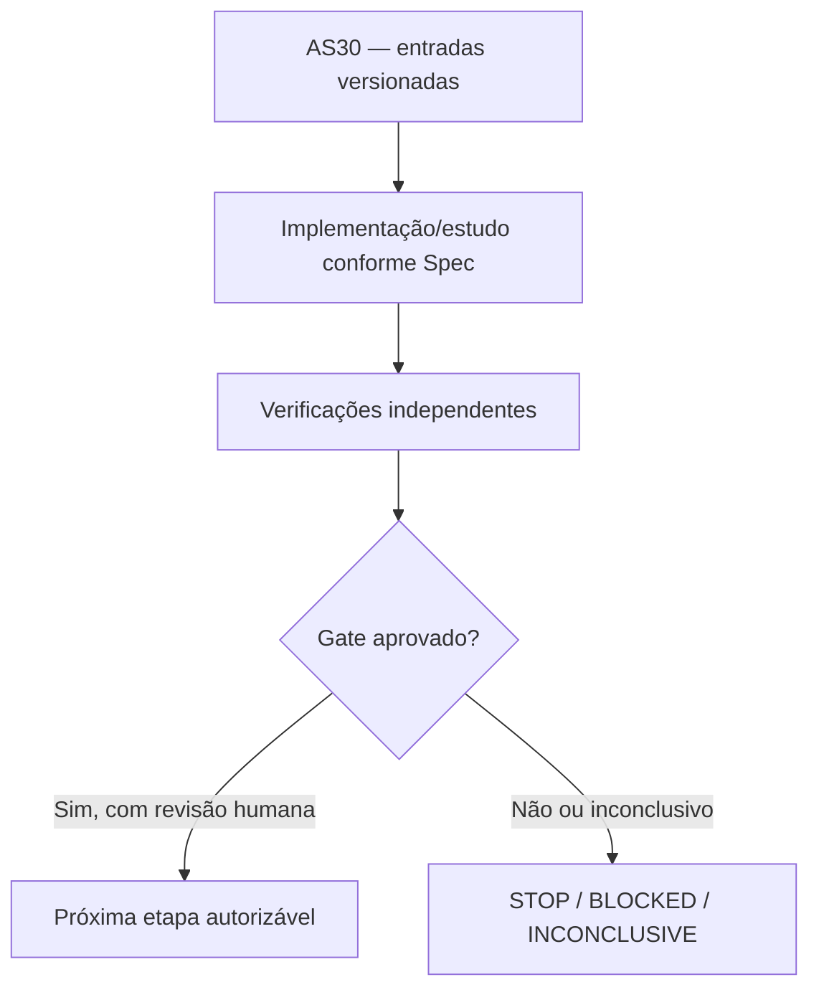

# AS30 — Design técnico

**Spec:** `specs/as-30-yrbc-validacao-matematica/spec.md`
**Status:** DRAFT — não implementado.

## Architecture Overview

**Contexto de decisão:** A construção Y-RBC apoia-se em três afirmações matemáticas ainda não auditadas independentemente: dominância de vizinhanças fechadas em H, projeção do fluxo por BF e validade de BR, inclusive quando S∩T não é vazio. Uma redução incorreta pode excluir o ótimo e invalidar toda a futura campanha.

## Abordagem e fronteiras

R-dom: para quaisquer u≠v com N_H[u]⊆N_H[v], validar substituição simultânea de todos u removidos por representantes máximos; distinguir manter pontos do grafo de permitir estação e eliminar arcos de trânsito apenas nos papéis corretos. Conferir se B_C⊆B_C' por reencaminhamento e se correspondência funciona com C que já contém v, terminais e S∩T. BF: escrever N(y) integral, σ→s, t→τ, permanência em S∩T, κ_v dependente dos papéis, separar apenas cortes finitos e verificar δ=m−c0>0. BR: caracterização combinatória e y(Z)≥1; a frase "todas as BF=projeção exata" exige prova do teorema max-flow/min-cut para cada y, e a inclusão com BR exige prova independente. Casos m=1, origem=destino, gêmeos, relé terminal obrigatório, grafo conectado com caminhos alternativos, cortes de capacidade zero.

## Code Reuse Analysis

| Fonte existente | Papel / verificação necessária |
|---|---|
| `docs/technical/reference/tecnico/direcoes-pli-min-station.md` | Reutilizar apenas depois de conferir versão, semântica, hashes e permissões. |
| `experiments/cuts/cuts.py` | Reutilizar apenas depois de conferir versão, semântica, hashes e permissões. |
| `experiments/cuts/bc_yspace.py` | Reutilizar apenas depois de conferir versão, semântica, hashes e permissões. |
| `experiments/cuts/test_*.py` | Reutilizar apenas depois de conferir versão, semântica, hashes e permissões. |
| `docs/context-ai/base-formulation.md` | Reutilizar apenas depois de conferir versão, semântica, hashes e permissões. |
| `docs/technical/reference/documentacao-projeto/overlap-ijcai2026-min-station.md` | Reutilizar apenas depois de conferir versão, semântica, hashes e permissões. |

## Components and Interfaces

| Artefato previsto | Responsabilidade |
|---|---|
| `docs/technical/reference/tecnico/as30-prova-dominancia-yrbc.md` | Documento/manifesto auditável |
| `docs/technical/reference/tecnico/as30-projecao-bf-br.md` | Documento/manifesto auditável |
| `experiments/yrbc/test_as30_math.py` | Implementação isolada e testada |
| `specs/as-30-yrbc-validacao-matematica/validation.md` | Documento/manifesto auditável |

## Contratos de integridade e evidência

- Toda instância recebe ID físico, SHA-256 bruto, classe, partição, autonomia `r` e cardinalidades `|S|`, `|T|`.
- Todo teste numérico tem versão de Gurobi, configuração, seed, limite de trabalho, tempo, status e natureza da certificação.
- Uma incumbente `y` só conta como UB físico depois de validação independente de viabilidade; ótimo do núcleo é apenas LB, salvo validação adicional.
- Resultados censurados e falhas de certificado são explícitos e contam na cobertura.
- Mudança de política após resultado é exploratória e exige novo pré-registro; sem reclassificação retroativa.
- Nenhuma etapa possui permissão implícita para fazer push, mexer nos dados de avaliação ou desbloquear AS26.

## Risks & Concerns

| Risco concreto | Consequência | Mitigação |
|---|---|---|
| A prova por componentes pode falhar se o reencaminhamento em H não preservar adjacências terminais | Falso ganho, incorretude ou baixa reprodutibilidade | Exigir o certificado/teste e registrar STOP/INCONCLUSIVE quando faltar prova. |
| Remoção de arcos pode cortar caminhos de terminal se papéis forem tratados incorretamente | Falso ganho, incorretude ou baixa reprodutibilidade | Exigir o certificado/teste e registrar STOP/INCONCLUSIVE quando faltar prova. |
| No MIPSOL um corte inválido compromete a corretude de todo o algoritmo | Falso ganho, incorretude ou baixa reprodutibilidade | Exigir o certificado/teste e registrar STOP/INCONCLUSIVE quando faltar prova. |

## Tech Decisions

| Decisão | Escolha | Racional |
|---|---|---|
| Escopo temporal | AS30 somente; sem executar a etapa seguinte | Gates devem ser aprovados separadamente. |
| Organização | `specs/as-XX-*` | Padrão concreto já utilizado pelo MIN-STATION, apesar do default `.specs/features/` da skill. |
| Validação | Scripts `validate_spec.py` e `validate_tasks.py` da skill | Passam nos diretórios explicitamente apontados. |
| Gate | G1 — Correção provada e microvalidada | G1 PASS apenas se nenhuma instalação física válida excluída, nenhum ótimo perdido na bateria exaustiva, prova R-dom e BF/BR completas com S∩T, validação independente e testes anti-mutação. Qualquer contraexemplo ou prova incompleta => G1 BLOCKED; não executar AS31. |

## Critérios de abstenção

- Se prova, comparação ou certificado estiverem incompletos: registrar hipótese/INCONCLUSIVE e não inferir GO.
- Se o teste contradisser uma hipótese matemática: registrar contraexemplo com instância mínima e bloquear dependentes.
- Se não houver Gurobi disponível: executar apenas testes independentes e dry-run, sem preencher resultados MIP fictícios.
