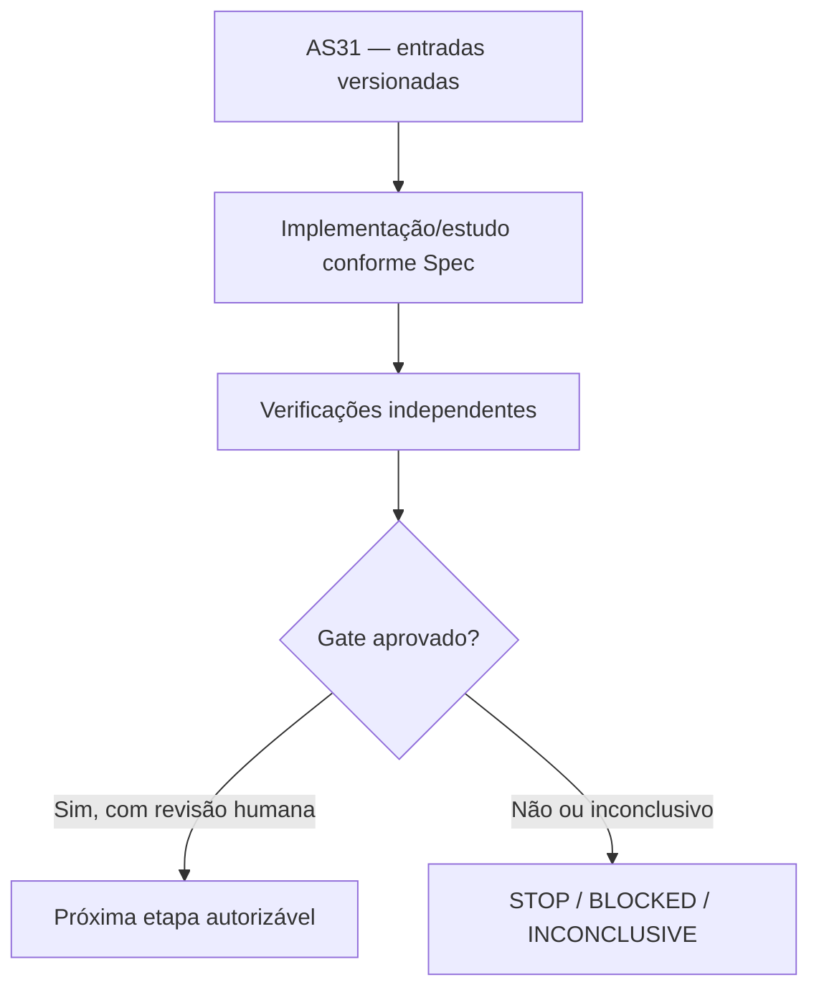

# AS31 — Design técnico

**Spec:** `specs/as-31-yrbc-reducoes-preprocessamento/spec.md`
**Status:** DRAFT — não implementado.

## Architecture Overview

**Contexto de decisão:** As sondas do Astra fixaram 68,3% de candidatos em Vienna e 48,4% em MAPF Room, mas usaram uma seed, sem pré-registro. Reduções antigas do projeto tiveram resultados mistos. É necessário separar ganho de tamanho, raiz e MIP em uma comparação controlada, sem alterar a semântica física.

## Abordagem e fronteiras

Separar o efeito das fixações de R-dom da remoção física de arcos: por padrão fixar y_u=0 e remover somente arcos cujo uso como trânsito dependeria de y_u, preservando caminhos de início/fim. Definir flags de ablação: original, fixações apenas, fixações+arcos, e comparador legado se compatível. Registros para Vienna e Room em sondas do Astra são exploratórios e não entram na estatística confirmatória. Uma redução que corta muitos arcos e acelera LP, mas piora significativamente o bound ou tempo MIP, não recebe GO. Candidatos PUC com 0% dominância permanecem no denominador. Artefatos JSON append-only, evitar seleção por resultado observado.

## Code Reuse Analysis

| Fonte existente | Papel / verificação necessária |
|---|---|
| `experiments/preprocessing/` | Reutilizar apenas depois de conferir versão, semântica, hashes e permissões. |
| `experiments/alternative-formulations/as02_model_a.py` | Reutilizar apenas depois de conferir versão, semântica, hashes e permissões. |
| `results/benchmark/linha_base.csv` | Reutilizar apenas depois de conferir versão, semântica, hashes e permissões. |
| `instances/manifest.csv` | Reutilizar apenas depois de conferir versão, semântica, hashes e permissões. |
| `docs/technical/reference/baseline-e-metodo/protocolo-comparacao-pareada.md` | Reutilizar apenas depois de conferir versão, semântica, hashes e permissões. |

## Components and Interfaces

| Artefato previsto | Responsabilidade |
|---|---|
| `docs/technical/plans/execucao/as31-preregistro-dominancia.json` | Documento/manifesto auditável |
| `experiments/yrbc/run_as31_reductions.py` | Implementação isolada e testada |
| `experiments/yrbc/analyze_as31_reductions.py` | Implementação isolada e testada |
| `docs/technical/reference/experimentos/as31-dominancia-resultado.md` | Documento/manifesto auditável |

## Contratos de integridade e evidência

- Toda instância recebe ID físico, SHA-256 bruto, classe, partição, autonomia `r` e cardinalidades `|S|`, `|T|`.
- Todo teste numérico tem versão de Gurobi, configuração, seed, limite de trabalho, tempo, status e natureza da certificação.
- Uma incumbente `y` só conta como UB físico depois de validação independente de viabilidade; ótimo do núcleo é apenas LB, salvo validação adicional.
- Resultados censurados e falhas de certificado são explícitos e contam na cobertura.
- Mudança de política após resultado é exploratória e exige novo pré-registro; sem reclassificação retroativa.
- Nenhuma etapa possui permissão implícita para fazer push, mexer nos dados de avaliação ou desbloquear AS26.

## Risks & Concerns

| Risco concreto | Consequência | Mitigação |
|---|---|---|
| A regra de arco não pode impedir chegada/partida gratuita de terminal | Falso ganho, incorretude ou baixa reprodutibilidade | Exigir o certificado/teste e registrar STOP/INCONCLUSIVE quando faltar prova. |
| Fixações dominam LP por redução de espaço mas não garantem B&B mais rápido | Falso ganho, incorretude ou baixa reprodutibilidade | Exigir o certificado/teste e registrar STOP/INCONCLUSIVE quando faltar prova. |
| Comparadores históricos tiveram versões e seeds diferentes | Falso ganho, incorretude ou baixa reprodutibilidade | Exigir o certificado/teste e registrar STOP/INCONCLUSIVE quando faltar prova. |

## Tech Decisions

| Decisão | Escolha | Racional |
|---|---|---|
| Escopo temporal | AS31 somente; sem executar a etapa seguinte | Gates devem ser aprovados separadamente. |
| Organização | `specs/as-XX-*` | Padrão concreto já utilizado pelo MIN-STATION, apesar do default `.specs/features/` da skill. |
| Validação | Scripts `validate_spec.py` e `validate_tasks.py` da skill | Passam nos diretórios explicitamente apontados. |
| Gate | G2a — Relevância computacional da dominância | G2a GO_CANDIDATE_REVIEW se ≥2 grafos brutos independentes apresentarem redução ≥50% no tempo de raiz sem piorar bound, OU melhora de tempo até OPT ≥2×, OU melhora inteira de LB/UB ≥1 estação, com evidência MIP e sem regressão grave em outros casos. STOP se não houver efeito de MIP e pouca redução útil fora de PUC; INCONCLUSIVE em censuras/variabilidade. Revisão humana autoriza AS32 somente após GO. |

## Critérios de abstenção

- Se prova, comparação ou certificado estiverem incompletos: registrar hipótese/INCONCLUSIVE e não inferir GO.
- Se o teste contradisser uma hipótese matemática: registrar contraexemplo com instância mínima e bloquear dependentes.
- Se não houver Gurobi disponível: executar apenas testes independentes e dry-run, sem preencher resultados MIP fictícios.
