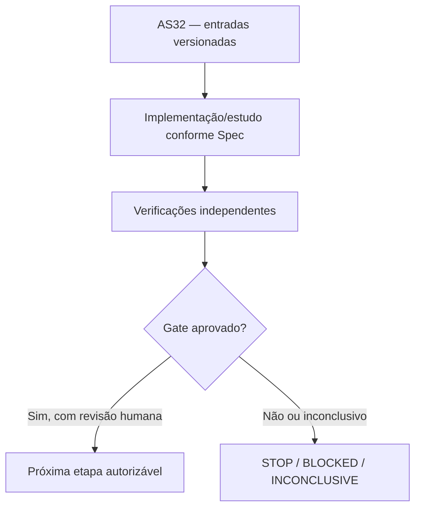

# AS32 — Design técnico

**Spec:** `specs/as-32-yrbc-prototipo-envelope/spec.md`
**Status:** DRAFT — não implementado.

## Architecture Overview

**Contexto de decisão:** BC-y/CBI antigos já mostraram alto custo de callbacks, fraca incumbente inicial e perda para COMP no regime de redes TNTP. Y-RBC deve demonstrar mecanismo novo e vantagem em instâncias principais do problema de Das sem apenas renomear os callbacks anteriores.

## Abordagem e fronteiras

BF: exibir corte ∑κ_v y_v≥δ e manter κ não uniforme nos terminais; descartar se residual/mincut não certificado, sem converter automaticamente em y(Z)≥1 em nós fracionários. BR: y(Z)≥1 apenas se oráculo confirmar V\Z inviável (ou certificado equivalente); podem ser múltiplos cortes diversos por incumbente somente com validação individual. MIPNODE: otimizar rede restrita a suportes + terminais, mas para y=0 assegurar que mincut ainda possa recuperar Z contendo vértices de custo nulo, sem afirmar validade de cortes omitidos. Oráculo exact matching de H[C] e terminal endpoints; não permitir MIP start inválido. Ablação com R-dom, BF, BR e heurística ligados/desligados, com custo dos callbacks. G2b mede melhoria em orçamento equivalente contra envelope pareado; não garante ganho por construção.

## Code Reuse Analysis

| Fonte existente | Papel / verificação necessária |
|---|---|
| `experiments/cuts/bc_yspace.py` | Reutilizar apenas depois de conferir versão, semântica, hashes e permissões. |
| `experiments/cuts/cuts.py` | Reutilizar apenas depois de conferir versão, semântica, hashes e permissões. |
| `experiments/cuts/yspace.py` | Reutilizar apenas depois de conferir versão, semântica, hashes e permissões. |
| `experiments/cuts/primal.py` | Reutilizar apenas depois de conferir versão, semântica, hashes e permissões. |
| `docs/technical/reference/experimentos/resultados-e8-pli.md` | Reutilizar apenas depois de conferir versão, semântica, hashes e permissões. |
| `results/benchmark/linha_base.csv` | Reutilizar apenas depois de conferir versão, semântica, hashes e permissões. |

## Components and Interfaces

| Artefato previsto | Responsabilidade |
|---|---|
| `experiments/yrbc/yrbc_solver.py` | Implementação isolada e testada |
| `experiments/yrbc/yrbc_cut_oracle.py` | Implementação isolada e testada |
| `experiments/yrbc/yrbc_primal.py` | Implementação isolada e testada |
| `experiments/yrbc/run_as32_envelope.py` | Implementação isolada e testada |
| `docs/technical/reference/experimentos/as32-yrbc-envelope.md` | Documento/manifesto auditável |

## Contratos de integridade e evidência

- Toda instância recebe ID físico, SHA-256 bruto, classe, partição, autonomia `r` e cardinalidades `|S|`, `|T|`.
- Todo teste numérico tem versão de Gurobi, configuração, seed, limite de trabalho, tempo, status e natureza da certificação.
- Uma incumbente `y` só conta como UB físico depois de validação independente de viabilidade; ótimo do núcleo é apenas LB, salvo validação adicional.
- Resultados censurados e falhas de certificado são explícitos e contam na cobertura.
- Mudança de política após resultado é exploratória e exige novo pré-registro; sem reclassificação retroativa.
- Nenhuma etapa possui permissão implícita para fazer push, mexer nos dados de avaliação ou desbloquear AS26.

## Risks & Concerns

| Risco concreto | Consequência | Mitigação |
|---|---|---|
| Gurobi pode aceitar incumbente inválido se callback for encerrado antes de validar | Falso ganho, incorretude ou baixa reprodutibilidade | Exigir o certificado/teste e registrar STOP/INCONCLUSIVE quando faltar prova. |
| Rede restrita pode omitir candidatos y=0 e emitir corte espúrio | Falso ganho, incorretude ou baixa reprodutibilidade | Exigir o certificado/teste e registrar STOP/INCONCLUSIVE quando faltar prova. |
| Alta fração de callback já encerrou BC-y/CBI no histórico | Falso ganho, incorretude ou baixa reprodutibilidade | Exigir o certificado/teste e registrar STOP/INCONCLUSIVE quando faltar prova. |

## Tech Decisions

| Decisão | Escolha | Racional |
|---|---|---|
| Escopo temporal | AS32 somente; sem executar a etapa seguinte | Gates devem ser aprovados separadamente. |
| Organização | `specs/as-XX-*` | Padrão concreto já utilizado pelo MIN-STATION, apesar do default `.specs/features/` da skill. |
| Validação | Scripts `validate_spec.py` e `validate_tasks.py` da skill | Passam nos diretórios explicitamente apontados. |
| Gate | G2b — Potencial frente ao envelope | G2b GO_CANDIDATE_REVIEW: ao menos 2 grafos brutos independentes com melhoria verificável em bound/UB/tempo frente ao melhor comparador PAREADO, nenhum erro de viabilidade, callback medianamente <50% do tempo e cobertura suficiente; exigir não regressão em ≥4/6 comparáveis como critério secundário, não teto absoluto de LB* de outra execução. STOP se custo de callback >50% sistematicamente, nenhum ganho e retrocesso em ≥3 casos; INCONCLUSIVE se tempo/variância impedirem atribuição. |

## Critérios de abstenção

- Se prova, comparação ou certificado estiverem incompletos: registrar hipótese/INCONCLUSIVE e não inferir GO.
- Se o teste contradisser uma hipótese matemática: registrar contraexemplo com instância mínima e bloquear dependentes.
- Se não houver Gurobi disponível: executar apenas testes independentes e dry-run, sem preencher resultados MIP fictícios.
