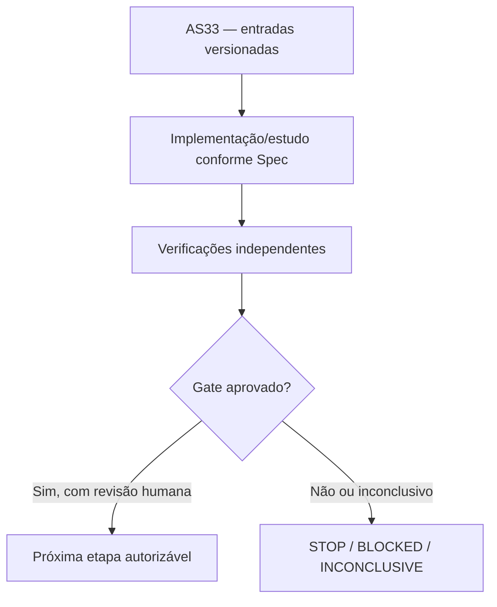

# AS33 — Design técnico

**Spec:** `specs/as-33-yrbc-piloto-integrado/spec.md`
**Status:** DRAFT — não implementado.

## Architecture Overview

**Contexto de decisão:** Uma triagem de potencial não garante robustez do algoritmo em execução inteira completa. O piloto deve tornar Y-RBC reprodutível, medível e seguro, com mecanismos de cortes no callback e ablações de tempo e memória.

## Abordagem e fronteiras

Usar APIs de callback suportadas pela versão Gurobi efetiva; nenhuma interrupção antes da validação de MIPSOL. Runner com watchdog para tempo externo, Gurobi WorkLimit determinístico e registro de tempo Python fora do solver. Cada instância persistirá matriz com sumário de BF/BR gerados, duplicados, descartados, validados, por nó, e tempo de oráculo. O protótipo AS32 é congelado antes de refatoração; aceitar mudança somente com regressão de certificados e microtestes. Custos de compilação da rede restrita e seleção de cortes separados do tempo do solve.

## Code Reuse Analysis

| Fonte existente | Papel / verificação necessária |
|---|---|
| `experiments/yrbc/yrbc_solver.py` | Reutilizar apenas depois de conferir versão, semântica, hashes e permissões. |
| `experiments/yrbc/yrbc_cut_oracle.py` | Reutilizar apenas depois de conferir versão, semântica, hashes e permissões. |
| `experiments/cuts/bc_yspace.py` | Reutilizar apenas depois de conferir versão, semântica, hashes e permissões. |
| `docs/technical/reference/baseline-e-metodo/protocolo-comparacao-pareada.md` | Reutilizar apenas depois de conferir versão, semântica, hashes e permissões. |

## Components and Interfaces

| Artefato previsto | Responsabilidade |
|---|---|
| `experiments/yrbc/yrbc_telemetry.py` | Implementação isolada e testada |
| `experiments/yrbc/run_as33_pilot.py` | Implementação isolada e testada |
| `experiments/yrbc/test_as33_integration.py` | Implementação isolada e testada |
| `docs/technical/reference/experimentos/as33-piloto-yrbc.md` | Documento/manifesto auditável |

## Contratos de integridade e evidência

- Toda instância recebe ID físico, SHA-256 bruto, classe, partição, autonomia `r` e cardinalidades `|S|`, `|T|`.
- Todo teste numérico tem versão de Gurobi, configuração, seed, limite de trabalho, tempo, status e natureza da certificação.
- Uma incumbente `y` só conta como UB físico depois de validação independente de viabilidade; ótimo do núcleo é apenas LB, salvo validação adicional.
- Resultados censurados e falhas de certificado são explícitos e contam na cobertura.
- Mudança de política após resultado é exploratória e exige novo pré-registro; sem reclassificação retroativa.
- Nenhuma etapa possui permissão implícita para fazer push, mexer nos dados de avaliação ou desbloquear AS26.

## Risks & Concerns

| Risco concreto | Consequência | Mitigação |
|---|---|---|
| Callback externo pode ultrapassar relógio da otimização | Falso ganho, incorretude ou baixa reprodutibilidade | Exigir o certificado/teste e registrar STOP/INCONCLUSIVE quando faltar prova. |
| Diferença de tempo de preparação e de solver pode enviesar resultados | Falso ganho, incorretude ou baixa reprodutibilidade | Exigir o certificado/teste e registrar STOP/INCONCLUSIVE quando faltar prova. |
| Maior número de cortes pode piorar desempenho inteiro | Falso ganho, incorretude ou baixa reprodutibilidade | Exigir o certificado/teste e registrar STOP/INCONCLUSIVE quando faltar prova. |

## Tech Decisions

| Decisão | Escolha | Racional |
|---|---|---|
| Escopo temporal | AS33 somente; sem executar a etapa seguinte | Gates devem ser aprovados separadamente. |
| Organização | `specs/as-XX-*` | Padrão concreto já utilizado pelo MIN-STATION, apesar do default `.specs/features/` da skill. |
| Validação | Scripts `validate_spec.py` e `validate_tasks.py` da skill | Passam nos diretórios explicitamente apontados. |
| Gate | G3 — Integração estável | G3 PASS somente com zero incumbente fisicamente inválida, zero corte errado, saída reproduzível e trace completo para todos os casos concluídos; tempo callback conhecido e guardas auditadas. G3 BLOCKED com falha de corretude ou registros incompletos; resultado computacional ruim é STOP científico, não bug encoberto. |

## Critérios de abstenção

- Se prova, comparação ou certificado estiverem incompletos: registrar hipótese/INCONCLUSIVE e não inferir GO.
- Se o teste contradisser uma hipótese matemática: registrar contraexemplo com instância mínima e bloquear dependentes.
- Se não houver Gurobi disponível: executar apenas testes independentes e dry-run, sem preencher resultados MIP fictícios.
