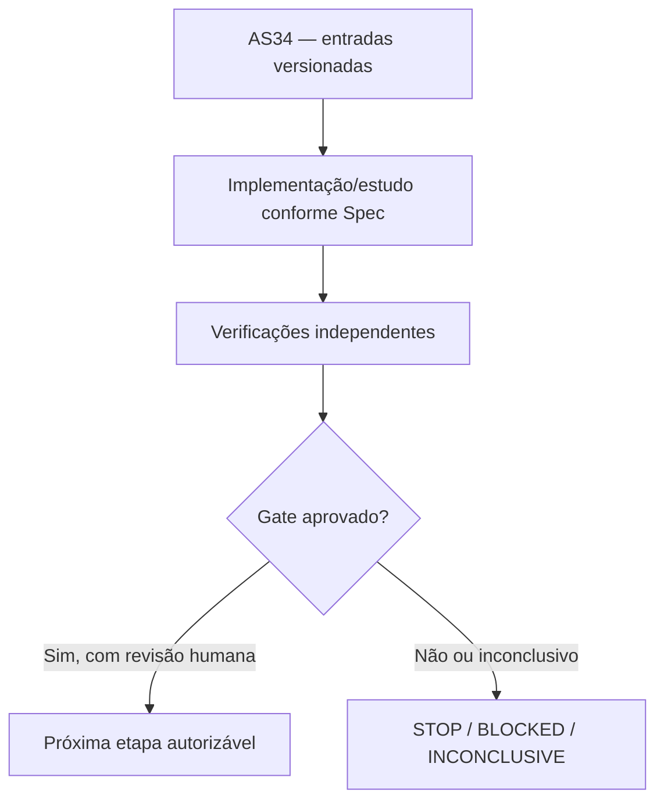

# AS34 — Design técnico

**Spec:** `specs/as-34-yrbc-comparacao-pareada/spec.md`
**Status:** DRAFT — não implementado.

## Architecture Overview

**Contexto de decisão:** Uma melhora em poucas instâncias de desenvolvimento pode desaparecer com seeds diferentes e limites de trabalho mais longos. A comparação confirmatória precisa determinar se Y-RBC é competitivo com COMP+K, núcleo e BC-y/CBI sem misturar resultados não comparáveis.

## Abordagem e fronteiras

Acompanhamento de primal validada, bound válido, gap, nós, tempo wall, WorkLimit, RSS, tempo callback, tempo de raiz e tempo até ótimo. Usar a mesma instância física e código comum de ingestão. A baseline anterior com WorkLimit=164 é só referência histórica: corrida confirmatória usa orçamento comum congelado a todos os métodos, sem comparações diretas de tempos com histórico. Separar `TIME_LIMIT`, `WORK_LIMIT`, `OPTIMAL`, `INFEASIBLE`, `ERROR`, `MEMORY_LIMIT` e falhas de certificação. Decisão baseada em Pareto robusta (não necessariamente vencer todas métricas).

## Code Reuse Analysis

| Fonte existente | Papel / verificação necessária |
|---|---|
| `experiments/benchmark/` | Reutilizar apenas depois de conferir versão, semântica, hashes e permissões. |
| `experiments/cuts/bc_yspace.py` | Reutilizar apenas depois de conferir versão, semântica, hashes e permissões. |
| `results/benchmark/linha_base.csv` | Reutilizar apenas depois de conferir versão, semântica, hashes e permissões. |
| `docs/technical/reference/baseline-e-metodo/protocolo-comparacao-pareada.md` | Reutilizar apenas depois de conferir versão, semântica, hashes e permissões. |

## Components and Interfaces

| Artefato previsto | Responsabilidade |
|---|---|
| `docs/technical/plans/execucao/as34-preregistro-comparacao.json` | Documento/manifesto auditável |
| `experiments/yrbc/run_as34_comparison.py` | Implementação isolada e testada |
| `experiments/yrbc/analyze_as34_comparison.py` | Implementação isolada e testada |
| `docs/technical/reference/experimentos/as34-comparacao-yrbc.md` | Documento/manifesto auditável |

## Contratos de integridade e evidência

- Toda instância recebe ID físico, SHA-256 bruto, classe, partição, autonomia `r` e cardinalidades `|S|`, `|T|`.
- Todo teste numérico tem versão de Gurobi, configuração, seed, limite de trabalho, tempo, status e natureza da certificação.
- Uma incumbente `y` só conta como UB físico depois de validação independente de viabilidade; ótimo do núcleo é apenas LB, salvo validação adicional.
- Resultados censurados e falhas de certificado são explícitos e contam na cobertura.
- Mudança de política após resultado é exploratória e exige novo pré-registro; sem reclassificação retroativa.
- Nenhuma etapa possui permissão implícita para fazer push, mexer nos dados de avaliação ou desbloquear AS26.

## Risks & Concerns

| Risco concreto | Consequência | Mitigação |
|---|---|---|
| Seeds e máquina com carga causam variação alta | Falso ganho, incorretude ou baixa reprodutibilidade | Exigir o certificado/teste e registrar STOP/INCONCLUSIVE quando faltar prova. |
| Comparar primal inválida do núcleo como UB seria incorreto | Falso ganho, incorretude ou baixa reprodutibilidade | Exigir o certificado/teste e registrar STOP/INCONCLUSIVE quando faltar prova. |
| Campanha longa facilita mudança informal de parâmetros | Falso ganho, incorretude ou baixa reprodutibilidade | Exigir o certificado/teste e registrar STOP/INCONCLUSIVE quando faltar prova. |

## Tech Decisions

| Decisão | Escolha | Racional |
|---|---|---|
| Escopo temporal | AS34 somente; sem executar a etapa seguinte | Gates devem ser aprovados separadamente. |
| Organização | `specs/as-XX-*` | Padrão concreto já utilizado pelo MIN-STATION, apesar do default `.specs/features/` da skill. |
| Validação | Scripts `validate_spec.py` e `validate_tasks.py` da skill | Passam nos diretórios explicitamente apontados. |
| Gate | G4 — Competitividade reproduzida | G4 GO: vantagem estatística/operacional consistente em ≥2 grafos brutos independentes e ≥2 sementes por caso, sem invalidez física, sem regressão grave no conjunto e com ganhos relevantes no LB, UB, gap ou tempo; thresholds operacionais deverão ser congelados numericamente no pré-registro antes do solve. STOP se não houver melhoria robusta ou houver custo superior sem benefício; INCONCLUSIVE se censuras dominarem. |

## Critérios de abstenção

- Se prova, comparação ou certificado estiverem incompletos: registrar hipótese/INCONCLUSIVE e não inferir GO.
- Se o teste contradisser uma hipótese matemática: registrar contraexemplo com instância mínima e bloquear dependentes.
- Se não houver Gurobi disponível: executar apenas testes independentes e dry-run, sem preencher resultados MIP fictícios.
