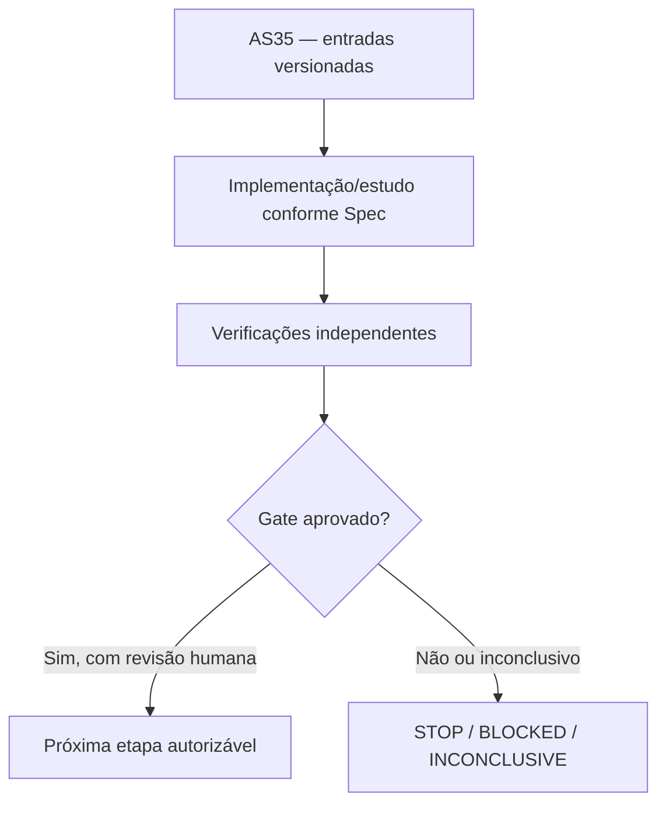

# AS35 — Design técnico

**Spec:** `specs/as-35-yrbc-avaliacao-reservada/spec.md`
**Status:** DRAFT — não implementado.

## Architecture Overview

**Contexto de decisão:** O histórico de cortes foi construído em poucos grafos de desenvolvimento. A contribuição só pode ser generalizada depois de testar política integralmente congelada em instâncias de avaliação não utilizadas para seleção/ajuste.

## Abordagem e fronteiras

Validar ausência de reads de instâncias reservadas em AS29–34 (além de metadados da partição) e fixar o hash da política. Uma execução de avaliação não pode rodar se arquivos de código ou parâmetros divergirem; flags de debugging devem estar desligadas. Comparadores usam o mesmo seed, trabalho e ambiente; qualquer falha é reportada com status; nenhum caso omitido do denominador. A conclusão deve separar 1) correção exata, 2) ganho computacional, 3) escalabilidade, 4) limites onde o método não compensa. Sem mudança de políticas após observar avaliação.

## Code Reuse Analysis

| Fonte existente | Papel / verificação necessária |
|---|---|
| `instances/manifest.csv` | Reutilizar apenas depois de conferir versão, semântica, hashes e permissões. |
| `docs/technical/reference/baseline-e-metodo/benchmark-v1.md` | Reutilizar apenas depois de conferir versão, semântica, hashes e permissões. |
| `docs/technical/reference/baseline-e-metodo/protocolo-comparacao-pareada.md` | Reutilizar apenas depois de conferir versão, semântica, hashes e permissões. |
| `experiments/yrbc/run_as34_comparison.py` | Reutilizar apenas depois de conferir versão, semântica, hashes e permissões. |

## Components and Interfaces

| Artefato previsto | Responsabilidade |
|---|---|
| `docs/technical/plans/execucao/as35-freeze-avaliacao.json` | Documento/manifesto auditável |
| `experiments/yrbc/run_as35_reserved.py` | Implementação isolada e testada |
| `docs/technical/reference/experimentos/as35-avaliacao-yrbc.md` | Documento/manifesto auditável |
| `specs/as-35-yrbc-avaliacao-reservada/validation.md` | Documento/manifesto auditável |

## Contratos de integridade e evidência

- Toda instância recebe ID físico, SHA-256 bruto, classe, partição, autonomia `r` e cardinalidades `|S|`, `|T|`.
- Todo teste numérico tem versão de Gurobi, configuração, seed, limite de trabalho, tempo, status e natureza da certificação.
- Uma incumbente `y` só conta como UB físico depois de validação independente de viabilidade; ótimo do núcleo é apenas LB, salvo validação adicional.
- Resultados censurados e falhas de certificado são explícitos e contam na cobertura.
- Mudança de política após resultado é exploratória e exige novo pré-registro; sem reclassificação retroativa.
- Nenhuma etapa possui permissão implícita para fazer push, mexer nos dados de avaliação ou desbloquear AS26.

## Risks & Concerns

| Risco concreto | Consequência | Mitigação |
|---|---|---|
| Vazamento de validação reservado destrói a independência | Falso ganho, incorretude ou baixa reprodutibilidade | Exigir o certificado/teste e registrar STOP/INCONCLUSIVE quando faltar prova. |
| Resultados com um único orçamento podem não generalizar | Falso ganho, incorretude ou baixa reprodutibilidade | Exigir o certificado/teste e registrar STOP/INCONCLUSIVE quando faltar prova. |
| Falhas de memória podem enviesar comparação se excluídas | Falso ganho, incorretude ou baixa reprodutibilidade | Exigir o certificado/teste e registrar STOP/INCONCLUSIVE quando faltar prova. |

## Tech Decisions

| Decisão | Escolha | Racional |
|---|---|---|
| Escopo temporal | AS35 somente; sem executar a etapa seguinte | Gates devem ser aprovados separadamente. |
| Organização | `specs/as-XX-*` | Padrão concreto já utilizado pelo MIN-STATION, apesar do default `.specs/features/` da skill. |
| Validação | Scripts `validate_spec.py` e `validate_tasks.py` da skill | Passam nos diretórios explicitamente apontados. |
| Gate | G5 — Generalização fora de desenvolvimento | G5 PASS técnico: 100% dos resultados rastreáveis ao freeze e 100% das incumbentes declaradas fisicamente válidas; verificação independente concluída. GO científico apenas com evidência robusta em reserva, sem omissões e com comparação justa. Caso contrário STOP, INCONCLUSIVE ou INVALIDATED (vazamento), nunca retuning silencioso. |

## Critérios de abstenção

- Se prova, comparação ou certificado estiverem incompletos: registrar hipótese/INCONCLUSIVE e não inferir GO.
- Se o teste contradisser uma hipótese matemática: registrar contraexemplo com instância mínima e bloquear dependentes.
- Se não houver Gurobi disponível: executar apenas testes independentes e dry-run, sem preencher resultados MIP fictícios.
